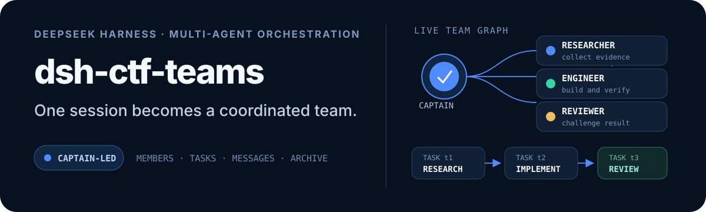
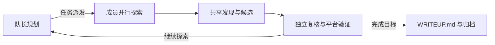

<p align="right">
  <a href="./README_EN.md">English</a> · <strong>简体中文</strong>
</p>

<h1 align="center">dsh-ctf-teams</h1>

<p align="center">
  <strong>让一个 DeepSeek Harness 会话，组织一支协同解题的 CTF 战队。</strong>
</p>

<p align="center">并行探索 · 共享证据 · 平台复核 · 持久化进度</p>

<p align="center">
  <a href="./package.json"></a>
  <a href="./compatibility.json"></a>
  <a href="./LICENSE"></a>
</p>

<p align="center">
  <a href="#quick-start">快速开始</a> ·
  <a href="#workflow">协作流程</a> ·
  <a href="#use-cases">使用场景</a> ·
  <a href="#configuration">配置</a> ·
  <a href="#documentation">文档</a>
</p>

<p align="center">
  
</p>

**CTFTeams** 是 DeepSeek Harness 的多智能体 CTF 插件。队长负责规划任务、协调成员和核对平台结果；成员从不同角度分析题目，在同一块看板上共享发现、脚本线索与候选 flag。任务、消息和复核记录持久化保存，便于续做、交接和生成可复现的解题记录。

适用于需要多条路线并行验证的题目，也支持批量刷题。简单附件解码可使用单人模式，保留同一套证据与归档流程。

## 核心能力

| 能力 | 实际用途 |
| --- | --- |
| **并行解题** | 默认四名全栈 CTF 成员，覆盖 Web、Pwn、Reverse、Crypto、Forensics、Misc；按攻击角度组织任务，阵容可自定义。 |
| **共享发现与独立复核** | 记录原始输出、推断、猜测和复现依据；队长单独登记复核结果，死胡同与纠正同样保留。 |
| **假设与实验台账** | 按题目共享可检验的预测、实验方法和观察结果，保留失败与纠正历史；可绑定工作区文件哈希，发现证据已变更。 |
| **解题记录检索** | 按需检索队内实验方法、任务结果和检查点，先看短摘要再展开；面板筛选证据并支持队长单条复核，减少重复探索。 |
| **证据依赖与队长交接** | 区分观察、解释和决策；前提失效后标记相关结论待复核。交接快照保留队长笔记和运行状态，恢复时显示变化。 |
| **候选 flag 审计** | 保留包装和大小写，格式不符只警告；返回持久化引用，支持独立候选变体及判定历史。平台接受结果由队长记录。 |
| **批量题目管理** | 按 `challenge_id` 统计不同题目的通过数；单题通过后继续其他任务，整批完成需要明确确认。 |
| **任务调度与资源排队** | 依赖完成后派发就绪任务，显示实际派发状态和等待原因；同战队的独占资源可串行使用。 |
| **故障恢复与交接** | 区分配置错误、限流和临时基础设施故障；合并重复通知，保留检查点与剩余事项，支持修复模型路由和重派任务。 |
| **解题面板** | 查看成员活动、任务进度、发现和 flag 判定；支持暂停、继续、核对候选、导出记录与归档。 |
| **工具与知识支持** | 内置分领域知识库、工具链检测和参考仓库同步；非视觉模型可使用 ASCII、OCR、QR/条码和像素比较入口。 |

<a id="quick-start"></a>

## 快速开始

### 1. 准备环境

| 项目 | 要求 |
| --- | --- |
| 宿主 | 已安装并可正常运行的 DeepSeek Harness；本轮增强功能在 `0.2.0-rc.2` 验收。 |
| Node.js | CLI / 源码环境使用 `22.x`（≥ `22.19.0`）或 `24+`，与 `package.json` 一致。 |
| 模型 | 宿主中已有可用的模型配置。成员默认沿用队长模型，也可按团队模板指定。 |
| 工作区 | 题目附件、解题脚本与输出所在的目录。工具链依题目需要准备。 |

宿主兼容采用两层策略：`0.2.1` 起的 `0.2.x`（含预发布）允许加载，运行时按实际 API 选择适配路径；精确验收版本单独记录在 [兼容性清单](./compatibility.json)。后续 RC / 补丁更新无需逐个加入白名单。`0.3.x` 及更高版本仍需审查；允许加载不等于已经验收。升级后可运行 `dsh-ctf-teams-doctor`，区分已测试版本、范围内未测试版本和依赖混装。见 [更新兼容说明](./docs/harness-forward-compatibility-2026-10-17/README.md)。

### 2. 安装本仓库版本

本 fork 的新增能力已提交到 GitHub，尚未发布到 npm；包名沿用 `@nanmicoder/dsh-ctf-teams`。获取本文所述功能请使用本仓库的 Git 地址或本地源码。

**桌面 / Web：** 在「插件 → 添加插件」中输入以下地址，安装后启用插件，并按宿主提示重启：

```text
git+https://github.com/MetaViii/dsh-ctf-teams.git
```

**CLI：** 在实际使用的 profile 中安装。下例以 `default` 为例，请替换为你的 profile 名称：

```bash
dsh plugin --profile default add git+https://github.com/MetaViii/dsh-ctf-teams.git
```

<details>
<summary>从本地源码安装</summary>

仓库包含预构建的 `lib/`，正常安装无需先批准构建脚本。

```bash
git clone https://github.com/MetaViii/dsh-ctf-teams.git
cd dsh-ctf-teams
dsh plugin --profile default add .
```

修改源码后的构建与检查方法见下方「开发与验证」。

</details>

### 3. 交给战队一项任务

重启宿主后新建会话。支持 agent 预设的界面可选择 **「CTF 团队模式」**，随后输入：

```text
/ctf-teams 分析 ./dist 中的附件，从不同角度验证解题路线，拿到平台接受的 flag 后整理 WRITEUP.md。
```

也可以直接描述需求：

```text
用 CTFTeams 解这道题。目标是 http://challenge.local:8000，附件在 ./dist。
先侦察，再并行验证可行路线。记录真实命令和输出，最终以平台判定为准。
```

默认配置 `autoApprove: true`，队长提交计划后即可派发就绪任务。需要先审阅计划时，设置 `autoApprove: false`，再通过面板的「批准并运行」启动。

打开 **「解题面板」** 查看进展；文本界面也可以使用：

```text
/ctf-teams-board
```

该命令直接读取看板，不产生新的模型轮次。

<a id="workflow"></a>

## 协作流程



1. **规划。** 记录题目信息与约束，建立侦察、路线验证和最终复核之间的任务依赖。
2. **探索。** 成员执行各自任务，通过轮次同步获取最新发现，及时公开有效结果、失败尝试和纠正。
3. **复核。** 成员结论保留为待验证声明；队长记录独立检查。候选 flag 原文不因格式警告而被改写。
4. **收敛。** 单题以平台接受为完成依据；批量模式按题计数，明确结束整批后再整理最终记录。

任务状态、当前尝试标识和邮箱消息均保存到工作区。成员交接会撤销旧尝试的写入权限，避免迟到结果覆盖新执行者；临时基础设施故障的检查点只用于续做，不作为完成证据。

默认 `ctf-teams` 阵容由队长规划任务图，初建零任务显示 `planning`。`ctf_teams_sync` 同时读取看板增量与调用者自己的未读消息，默认每次 10 组、最多 50 组；重要结论仍需 `report_finding` 入板。队长通过 `reassign_task` 接管任务时，会直接收到任务约定、检查点、剩余事项、看板增量与自己的未读消息。

本地第四轮增强可在建队时设置 `challenge_mode: "batch"`，从首轮启用多题语义。候选支持 `source_kind` / `source_url`，来源与真实题目 ID 随看板同步；来源记录不等于可信度认证。队长未完成的接管被回收时，邮箱会留下撤销通知。详见[第四轮选择性改进](./docs/ctf2-improvements-round4-2026-10-15/README.md)（当前尚未推送）。

### 解题面板

面板集中展示题目、成员、任务、发现、候选 flag 和下一步提示。常用操作包括：

| 操作 | 用途 |
| --- | --- |
| 开始解题 / 添加附件 | 提交题目上下文，选择工作区内的附件。 |
| 批准 / 推进 / 暂停 / 继续 | 控制计划和任务执行；队长专属操作按权限显示。 |
| 核对 flag | 让队长检查平台结果并登记对应候选的判定。 |
| 写 WRITEUP / 导出 | 整理解题链，导出 writeup 或复盘记录。 |
| 归档 / 清理 | 保留已完成战队的历史，或明确清理数据。 |

已归档战队可回看。平台靶机的生命周期独立于战队归档，释放槽位需要通过平台处理。

<a id="use-cases"></a>

## 使用场景

### 一道题，多条路线

```text
/ctf-teams 这道题同时包含 Web 服务与二进制附件。先做共同侦察，
再让成员分别验证输入处理、文件解析和二进制逻辑。避免重复劳动，
每个结论都附命令、脚本路径或原始输出。
```

默认阵容由 `agent-1` 至 `agent-4` 组成，每名成员均具备完整领域提示。提速来自不同角度的探索，队长根据题目决定任务分配；成员数量和提示词可通过 `profiles` 调整。

### 简单题，单人完成

```text
这是一道单步附件解码题，请用 CTFTeams 的 solo 模式直接完成，
保留发现、候选 flag、平台判定和最终解题记录。
```

`mode: "solo"` 只建立持久化看板，跳过成员、任务图和建队时的参考仓库同步，适合无需并行探索的工作。

### 批量刷题，逐题验收

```text
/ctf-teams 批量处理这一场的 23 道题。启用 multi_challenge，
expected_challenges 设为 23，每个任务和 flag 都记录真实 challenge_id。
一题通过后继续其他题；单容器槽位的任务排队执行，全部核验后明确结束整批。
```

批量模式按不同 `challenge_id` 计数，同一题的多个通过候选不会重复增加进度。`mark_challenge_solved` 用于明确结束整批；配置了预期题数时，未达到目标不能提前关闭。

<details>
<summary>模型工具调用示例：批量状态与候选登记</summary>

以下示例用于已创建战队的会话，运行在 Harness 的模型工具上下文中；普通使用时直接描述上述需求即可。候选登记与平台提交是两个步骤。

```js
await tools.ctf_teams_set_challenge({
  multi_challenge: true,
  expected_challenges: 23,
  flag_format: null
});

const candidate = await tools.ctf_teams_submit_flag({
  challenge_id: '题目的实际 ID',
  flag: 'CTF2{原始候选}',
  evidence: '解题脚本路径、执行命令与原始输出'
});

// 队长实际检查平台接受结果后，才登记 verified。
await tools.ctf_teams_mark_flag({
  flag_id: candidate.flag_ref,
  verdict: 'verified',
  note: '平台实际返回的接受依据'
});
```

</details>

### 稀缺环境、限流与非视觉模型

同战队任务可通过 `resource_key` 排队使用独占资源；`preflight` 在派发、认领与接管前检查环境、题目状态或已复核的离线自测。平台事实通过 `ctf_teams_platform_check` 只读刷新，未知、过期或属于其他题目的事实会阻塞相关任务。

本地第五轮增强允许有效队员刷新只读平台事实，队长可原地修正未启动任务的 preflight。代理与 CLI 会识别平台业务错误，防止把限流返回当作题目数据；status 和面板增加保存、在线及队长模型路由的差异诊断。详见[第五轮改进与取舍](./docs/ctf2-iteration5-2026-10-15/README.md)和[上游差异审查](./docs/ctf2-iteration5-2026-10-15/upstream-review.md)（尚未推送）。

队长可用 `update_member(wake:false)` 修复后保持停发，待服务恢复再用 `wake:true` 放行。失败任务已有同 ID 重派；任务成果已完成并有同题 verified 引用时，可显式 `resolve_task` 审计收尾，详见[本轮边界](./docs/ctf2-iteration10-2026-10-26/README.md)。配置错误会暂停成员并提示修复，限流展示上游提供的恢复时间；临时基础设施故障保留任务进度，冷却后自动恢复一次，再次失败等待修复或重派。模型无法读取图片时，可使用 `ctf_teams_image_to_text` 提取 ASCII、OCR 或 QR/条码候选，或进行像素比较；所需依赖按环境准备。

`ctf_teams_text_candidates` 可按需枚举 OCR 易混字符，最多 128 项，保留原文并提示截断；可查看 Base64 原始字节的 hex / 转义 ASCII。密码库检测执行基础 AES 运算，区分缺失与损坏的后端。附带的 CTF2 CLI 已修复多参数传递，并将空结果和工具错误作为非零退出处理。

详细用法与本轮建议取舍见 [第三轮改进记录](./docs/ctf2-improvements-2026-10-15/README.md)，资源预检与代理用法见 [CTF2 增强指南](./docs/ctf2-improvements-2026-10-14/README.md)。

<a id="configuration"></a>

## 配置

以下示例覆盖 profile 中的插件配置，适用于已安装插件的环境：

```yaml
- id: ctf-teams
  config:
    stateDir: .ctf-teams
    memberProvider: spawn
    maxMembers: 8
    defaultProfile: ctf-teams
    autoApprove: true
    slashCommand: true
    boardCommand: true
    env:
      allowInstall: true
      probeTimeoutMs: 10000
      installTimeoutMs: 300000
    references:
      autoSync: small
      depth: 1
```

| 设置 | 说明 |
| --- | --- |
| `autoApprove` | `true` 提交计划后运行；`false` 保留先审阅后批准的流程。 |
| `defaultProfile` / `profiles` | 默认团队模板与自定义阵容；同名模板覆盖内置配置。空字符串可关闭默认阵容。 |
| `memberModel` / 成员 `provider`、`model` | 设置成员模型；省略时按宿主与队长配置解析。可配置备用路由 `fallback`。 |
| `env.allowInstall` | 控制工具链安装执行；关闭后仍可检查与预览安装计划。重型工具提供手动安装提示。 |
| `references.autoSync` | 随附配置使用 `small`，建队时同步小型参考库；`off` 关闭，`all` 包含大型仓库。 |
| `ctf2` | 可选 CTF2 代理地址、超时与宿主管理设置；默认不启动托管代理。 |

修改配置后重启对应宿主。模型修复、资源条件和可选代理设置的完整示例见 [增强指南](./docs/ctf2-improvements-2026-10-14/README.md#使用方式)。

<details>
<summary>自定义两人阵容</summary>

在上面的 `config` 中加入团队模板：

```yaml
profiles:
  duo:
    description: 两名全栈成员，从不同角度探索
    taskPlanning: captain
    members:
      - name: analyst-1
        executionPrompt: 优先检查输入处理与协议行为，报告复现证据。
      - name: analyst-2
        executionPrompt: 优先检查附件与程序逻辑，及时同步有效结果和死胡同。
```

重启后通过 `/ctf-teams --profile duo <题目描述>` 显式选用；也可将 `defaultProfile` 设置为 `duo`。

</details>

### 知识库与参考资料

`ctf_teams_knowledge` 提供 Web、Pwn、Reverse、Crypto、Forensics、Misc 及 Kali、pwntools、SageMath、Volatility 3 等资料。`ctf_teams_env` 分别检查本机和明确选择的 WSL 发行版，不把 Windows PATH 的缺失结论套到 Linux。

```js
await tools.ctf_teams_env({ action: 'check', runtime: 'wsl' }); // 只列发行版
await tools.ctf_teams_env({
  action: 'check', runtime: 'wsl', distribution: 'kali-linux',
  tools: ['python3', 'pycryptodome', 'sage', '7z']
});
```

WSL 检查会显示实际发行版、Linux 搜索路径、解释器和逐项结果；超时或检查器故障标为 `unknown`，不算缺失，不触发自动安装。它只检查 Linux 系统目录和当前用户的 `~/.local/bin`、`~/bin`；自定义虚拟环境或其他路径需另行验证。WSL 模式只检查，安装仍需在对应发行版显式操作。

CTF2 CLI 读取题目或生成题库快照时，使用原子 UTF-8 输出，避免 shell 重定向提前清空旧缓存：

```powershell
node scripts/ctf2-cli.mjs get <challenge_id> <ground_id> --output challenge.json
node scripts/ctf2-cli.mjs scan-unsolved practice_ground_id=<ground_id> --output unsolved.json
```

限流、协议错误及分页未完成时，旧文件保留；输出目录须已存在。多条 lane 使用各自文件，原子替换不等于并发合并。完整范围见 [第六轮迭代记录](./docs/ctf2-iteration6-2026-10-18/README.md)。

`ctf_teams_references` 按需同步 CTF 技能、PoC 和 CVE 索引，包括 [ctf-skills](https://github.com/ljagiello/ctf-skills)、[Awesome-POC](https://github.com/WyAtu/Awesome-POC) 等。仓库保存在工作区，供成员检索；大型库按实际需要同步。

共享假设与实验的用法、文件证据边界和本轮验证见[第七轮迭代](./docs/ctf2-iteration7-2026-10-23/README.md)。

## 工具索引

日常使用通过自然语言和面板即可。编写自定义工作流时，可按以下分组查找工具：

| 工作流 | 主要工具 |
| --- | --- |
| 战队与计划 | `create`、`approve`、`edit_plan`、`add_member`、`update_member`、`remove_member` |
| 任务执行与交接 | `create_task`、`claim_task`、`update_task`、`reassign_task`、`amend_task` |
| 发现与复核 | `report_finding`、`verify_finding`、`evidence`、`hypothesis`、`sync` |
| 交接与增援 | `checkpoint`、`set_challenge(max_parallel_lanes)`；并行任务容量由调度器检查，队长根据反证与不同角度决定增援。 |
| 题目与 flag | `set_challenge`、`submit_flag`、`mark_flag`、`mark_challenge_solved` |
| 通信与状态 | `send_message`、`status`、`resume` |
| 解题支持 | `knowledge`、`env`、`references`、`image_to_text`、`text_candidates`、`platform_check` |
| 归档 | `delete`、`archive_summary` |

完整工具名均带 `ctf_teams_` 前缀。成员只获得协作所需工具；题目判定、独立复核与成员路由修复等操作由队长执行。

## 常见问题

**Windows 上 `pwsh` 在命令执行前报 `Microsoft.PowerShell.Security` / `Get-Acl`，或者没有 Bash？**

本地兼容修复会在 DSH 进程内优先放入 Windows PowerShell 自带模块目录，避免 dsh-ops 的 5.1 工作区引导误载继承的 PowerShell 7 模块；它不修改系统环境变量。PowerShell 工具可以使用 dsh-ops 自带的 7.x，不能只凭 PATH 搜索判断未安装。

Windows 的原生 `bash` 工具不能直接与 PowerShell 共用一个执行器；搭配 dsh-ops 时使用其独立的 `ops_bash`。本次部署补齐了经过固定哈希校验的 Bash 运行时，保留原有权限约束。实际原因、支持边界和验证记录见 [Windows 双 shell 修复](./docs/windows-shell-2026-10-15/README.md)。

**结束后反复出现“已完成，用时 1 秒”，轮次一直增长？**

旧调度器会把持续存在的“已解出”状态当作新消息，反复唤醒空闲队员；队员结束后触发的原生通知又会在队长会话留下空白轮次。本地修复已改为仅投递尚未消费的看板更新。队长的空白轮次可能在模型请求前被拦截，但队员的重复同步仍会消耗 token。

遇到此问题，先在 CTF 团队面板点击“暂停”，确认团队显示“已暂停”。修改源码不会更新已经安装的插件副本，需要重新构建、安装修复包并完整重启 DSH。新版面板暂停会落盘停止队伍，并在宿主目标服务可用时暂停当前会话目标；继续队伍不会自动恢复目标。诊断、验证范围与安装步骤见 [空转循环修复记录](./docs/ctf2-idle-loop-2026-10-15/README.md)。

**候选格式不符合正则，会被拒收吗？**

会保留候选并附上格式警告。可以设置多个格式，或以 `flag_format: null` 交由平台判断。嵌套包装与显式变体分别记录，原文不会被静默改写。

**`submit_flag` 会直接向比赛平台提交吗？**

该工具登记共享看板上的候选。实际平台提交通过平台工具或接入完成，队长检查后使用 `mark_flag` 记录结果。外部提交成功后的自动对账尚未实现。

**已经分配任务，为什么成员还没有开始？**

查看 `dispatch_state` 和 `dispatch_reason`。依赖、忙碌成员、待投递邮件、资源占用、故障或 preflight 都可能让任务等待。就绪任务由调度器派发，消息用于沟通和补充指导。

若状态、`get_goal`、文件和 shell 等工具同时报 `sessionProjections ... inactive context`，请按宿主运行时故障处理，停止反复重试并保留工作；这不是 shell 权限错误。只读诊断、关闭 profile 自动 HMR 的缓解配置及恢复边界见[运行时服务故障记录](./docs/session-projections-2026-10-16/README.md)。

**删除战队会释放平台容器吗？**

平台环境需要单独检查与释放。归档会保留历史并返回路径；配置为宿主管理的共享代理不随战队删除而停止。

**有哪些能力仍有边界？**

资源锁目前作用于同一战队，平台事实需要显式刷新；跨战队全局租约、外部提交与停止顺序的强制约束尚未实现。图片 OCR/条码需要对应依赖，提取结果仍须验证。详细状态见 [逐项实施清单](./docs/ctf2-improvements-2026-10-14/README.md#完成状态)。

<a id="documentation"></a>

## 文档

| 文档 | 内容 |
| --- | --- |
| [第三轮改进与取舍](./docs/ctf2-improvements-2026-10-15/README.md) | CLI 可靠性、同步与接管、OCR 候选、运算检测，逐项说明哪些建议采纳及未采纳。 |
| [本轮验证记录](./docs/ctf2-improvements-2026-10-15/validation.json) | 新回归、真实宿主与安装包验收的范围和结果。 |
| [协作知识库](./assets/ctf/knowledge/coordination.md) | 默认规划、队长接管、私信与发现、单环境排队及平台战绩核验。 |
| [CTF2 增强指南](./docs/ctf2-improvements-2026-10-14/README.md) | 批量解题、故障恢复、资源预检、图像降级与代理托管。 |
| [第二轮验证记录](./docs/ctf2-improvements-2026-10-14/validation.json) | 第二轮完整回归、真实宿主场景、安装包与图像测试的范围和结果。 |
| [第一轮改进记录](./docs/ctf2-improvements-2026-10-13/README.md) | 计划诊断、原始 flag、证据复核、solo 与归档增强。 |
| [兼容性清单](./compatibility.json) | 推荐与历史宿主版本范围。 |
| [维护指南](./docs/maintenance-workflow.md) | 兼容性、验证与发布规则。 |

本轮真实宿主验收使用确定性模型及平台判定样本，不代表已重新完成线上比赛测试，或已验证真实模型账号的配额恢复。

## 开发与验证

```bash
pnpm install
pnpm build             # 构建宿主、前端产物与 Git 分发校验戳记
pnpm typecheck
pnpm verify            # 项目完整回归
pnpm verify:ctf:harness # 当前已安装的精确宿主入口验收
```

修改源码后请同步提交生成的 `lib/`，保证 Git 安装获取到可运行的产物。纯文档改动使用 `pnpm verify:readme` 检查版本引用。反馈问题时请附宿主版本、安装来源、复现步骤及相关状态；可通过本仓库的 [Issues](https://github.com/MetaViii/dsh-ctf-teams/issues) 提交。

## 致谢与许可

本项目基于 [NanmiCoder/dsh-ctf-teams](https://github.com/NanmiCoder/dsh-ctf-teams) 继续维护，其多智能体底座来自程序员阿江（Relakkes）的 [dsh-agent-teams](https://github.com/NanmiCoder/dsh-agent-teams)。感谢上游的持久化成员、任务调度、消息与质量门设计，以及相关 CTF 知识库与参考资料的贡献者。

本项目采用 [MIT License](./LICENSE)。
